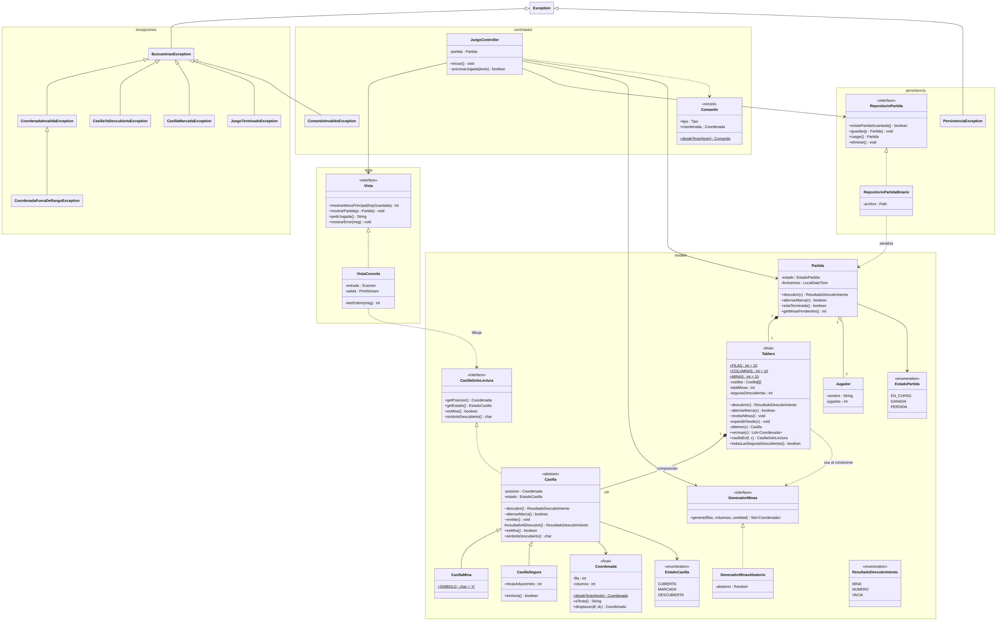

# Buscaminas en Consola (Java)

Proyecto del examen práctico final de **Programación Orientada a Objetos**.
Es el clásico Buscaminas jugado desde la consola: un tablero de 10 x 10 con
10 minas escondidas en posiciones aleatorias. El jugador escribe coordenadas
como `A5` para descubrir casillas, puede marcar las que cree que son minas y
gana cuando descubre todas las casillas seguras sin pisar ninguna mina.

**Autor:** Andy Ortiz

---

## Características

- Tablero de 10 x 10 (filas `A`–`J`, columnas `1`–`10`) con 10 minas aleatorias.
- Al descubrir una casilla:
  - `X` → era una mina: se pierde la partida y se muestran todas las minas.
  - `1`–`8` → número de minas vecinas (se cuentan también las diagonales).
  - `V` → casilla vacía: se descubren automáticamente todas las vecinas
    hasta llegar a casillas con número (expansión en cascada).
- Marcar y desmarcar casillas sospechosas (`B`), con contador de minas por marcar.
- El tablero se vuelve a dibujar después de cada acción.
- Se gana al descubrir las 90 casillas seguras.
- Guardar la partida en un archivo binario y continuarla después desde el menú.
- Mensajes claros ante entradas inválidas, sin que el programa se cierre.

## Requisitos

- **JDK 17** o superior (probado con JDK 25 de Eclipse).
- **Eclipse IDE for Java Developers** (2026‑09 o similar).
- **JUnit 5**, que ya viene incluido en Eclipse (no hace falta descargar nada).

## Instalación

### Opción 1: Eclipse (recomendada)

1. Clonar el repositorio:
   ```
   git clone https://github.com/soyandyortiz/POO-Examen-Buscaminas-AndyOrtiz.git
   ```
2. En Eclipse: **File → Import… → General → Existing Projects into Workspace**.
3. En *Select root directory* elegir la carpeta clonada y pulsar **Finish**.
   El proyecto `POO-Buscaminas-AndyOrtiz` ya trae configuradas las carpetas
   `src` y `test` y la librería JUnit 5.

### Opción 2: línea de comandos

```
javac -d bin -encoding UTF-8 src/buscaminas/**/*.java
java -cp bin buscaminas.app.Buscaminas
```
En Windows (PowerShell) se pueden compilar todas las clases así:
```
javac -d bin -encoding UTF-8 (Get-ChildItem -Recurse src -Filter *.java).FullName
java -cp bin buscaminas.app.Buscaminas
```

## Uso

Ejecutar la clase `buscaminas.app.Buscaminas`
(clic derecho → **Run As → Java Application**).

### Menú principal

```
 1. Nueva partida
 2. Continuar partida guardada   (solo aparece si existe una)
 3. Instrucciones
 0. Salir
```

### Comandos durante la partida

| Comando       | Acción                                         |
|---------------|------------------------------------------------|
| `A5`          | Descubre la casilla de la fila A, columna 5    |
| `M A5` o `MA5`| Marca o desmarca la casilla A5 como mina       |
| `G`           | Guarda la partida en `partida_guardada.dat`    |
| `S`           | Sale al menú (pregunta si se desea guardar)    |
| `?`           | Muestra las instrucciones                      |

Las letras pueden escribirse en minúscula (`a5`, `m b3`).

### Símbolos del tablero

| Símbolo | Significado                         |
|---------|-------------------------------------|
| `-`     | Casilla cubierta                    |
| `B`     | Casilla marcada como posible mina   |
| `V`     | Casilla vacía descubierta           |
| `1`–`8` | Cantidad de minas vecinas           |
| `X`     | Mina (se ven al perder la partida)  |

## Ejemplo de ejecución

Primera jugada en `E5`: la casilla está vacía y se abre toda la zona sin minas.

```
Jugador: Andy | Minas por marcar: 10 | Jugadas: 1 | Seguras descubiertas: 78/90
     1  2  3  4  5  6  7  8  9 10
 A   V  V  V  1  -  -  1  V  V  V
 B   V  V  1  2  -  -  2  1  V  V
 C   V  V  1  -  -  -  -  1  V  V
 D   V  V  1  1  1  1  1  1  V  V
 E   V  V  V  V  V  V  V  V  1  1
 F   V  1  1  1  V  V  V  1  2  -
 G   V  1  -  1  V  V  V  1  -  -
 H   1  2  1  1  V  V  V  1  -  -
 I   -  2  V  V  V  1  1  1  -  -
 J   -  2  V  V  V  1  -  -  -  -
Leyenda: - cubierta | B marcada | V vacía | 1-8 minas vecinas | X mina
Jugada -> [A5] descubrir | [M A5] marcar/desmarcar | [G] guardar | [S] salir | [?] ayuda
```

Errores que el juego controla sin cerrarse:

```
> E5
[ERROR] La casilla E5 ya está descubierta
> Z9
[ERROR] La casilla Z9 está fuera del tablero
> hola
[ERROR] 'HOLA' no es una coordenada válida; use una letra y un número, por ejemplo A5
```

En el menú, escribir letras en lugar de un número también se controla
(`InputMismatchException`): aparece `[ERROR] Debe ingresar un número entero`
y se vuelve a pedir la opción.

## Estructura del proyecto (MVC)

```
src/buscaminas
├── app            → Buscaminas (main: arma el MVC y arranca el juego)
├── modelo         → Tablero, Casilla, CasillaMina, CasillaSegura, Partida,
│   │                Jugador, Coordenada, GeneradorMinas, enums de estado
│   └── excepciones→ BuscaminasException y sus subclases
│                    (CasillaYaDescubiertaException, CoordenadaFueraDeRangoException…)
├── persistencia   → RepositorioPartida (interfaz) y RepositorioPartidaBinario
├── vista          → Vista (interfaz) y VistaConsola
└── controlador    → JuegoController y Comando
test/buscaminas    → pruebas unitarias JUnit 5 de cada paquete
docs               → diagrama de clases UML
```

- **Modelo:** reglas del juego. No imprime nada ni lee del teclado.
- **Vista:** todo lo que se muestra y se lee por consola.
- **Controlador:** recibe lo que escribe el jugador, llama al modelo y le
  pide a la vista que muestre el resultado.

### Diagrama de clases



## Conceptos de POO aplicados

- **Encapsulamiento:** atributos privados; las operaciones que cambian el
  tablero son de paquete y solo se usan a través de `Partida`.
- **Herencia y polimorfismo:** `Casilla` es abstracta y `CasillaMina` /
  `CasillaSegura` deciden qué pasa al descubrirlas y qué símbolo muestran.
- **Interfaces:** `CasillaSoloLectura`, `GeneradorMinas`, `RepositorioPartida`
  y `Vista` permiten cambiar implementaciones (por ejemplo, minas fijas en las
  pruebas o una vista simulada).
- **Asociaciones:** composición `Tablero` → `Casilla`, `Partida` → `Tablero`
  y agregación `Partida` → `Jugador`.

## Manejo de excepciones y archivos

- `InputMismatchException`: cuando en el menú se escribe texto en vez de un número.
- `ArrayIndexOutOfBoundsException`: se captura al acceder a una posición fuera
  de la matriz y se convierte en `CoordenadaFueraDeRangoException`.
- `CasillaYaDescubiertaException`: excepción propia al intentar descubrir
  una casilla ya abierta.
- La partida se guarda por **serialización binaria** (`ObjectOutputStream`)
  en `partida_guardada.dat`. Primero se escribe un archivo temporal y luego se
  reemplaza el original, para no dañar una partida guardada si algo falla.
  Al ganar o perder, el archivo guardado se elimina.

## Pruebas unitarias y TDD

Las pruebas están en la carpeta `test` y usan **JUnit 5**.

Ejecutarlas en Eclipse: clic derecho sobre la carpeta `test` →
**Run As → JUnit Test**. Para ver la cobertura: **Coverage As → JUnit Test**.

El modelo se desarrolló con **TDD (Rojo → Verde → Refactorizar)**, y se puede
ver en el historial de commits:

1. **Rojo:** primero se escribieron las pruebas del modelo con los métodos
   vacíos; las pruebas fallaban.
2. **Verde:** se implementó la lógica mínima hasta que todas pasaron.
3. **Refactorizar:** se eliminó la duplicación al recorrer las casillas
   vecinas (principio **DRY**) creando `Tablero.vecinas()`, sin que ninguna
   prueba dejara de pasar.

## Código limpio

- **DRY:** un único método `vecinas()` para contar minas y para la expansión.
- **KISS:** la expansión de casillas vacías usa una cola (BFS) en lugar de
  recursión, más simple y sin riesgo de desbordar la pila.
- **YAGNI:** solo se implementó lo que pide el enunciado.
- Nombres descriptivos en español, métodos cortos y documentación **Javadoc**
  en todas las clases públicas.
